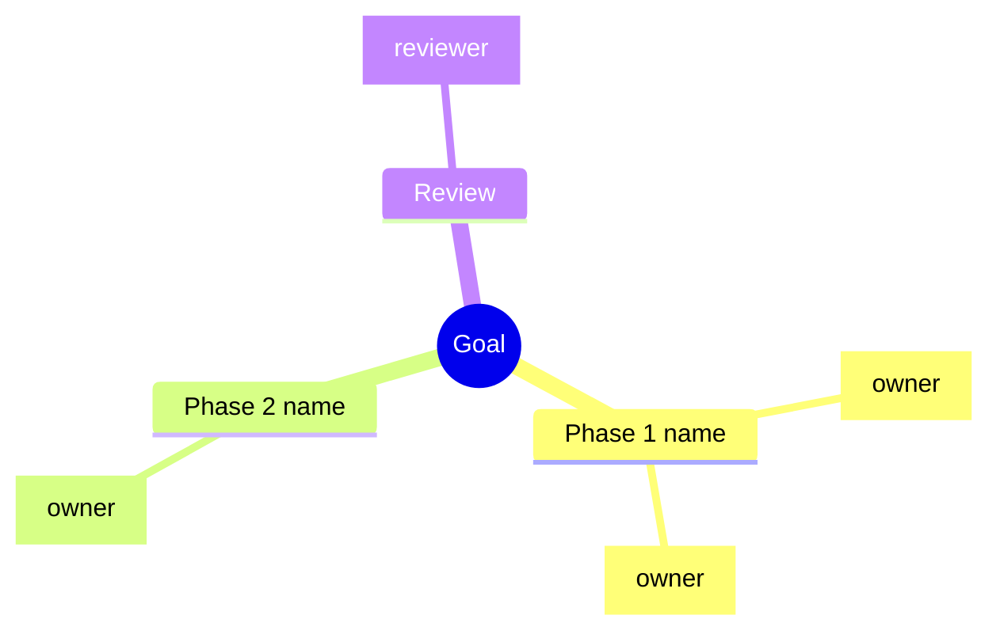

# Mindmap planner

Produce a Mermaid `mindmap` block:

Rules:
- Root = the goal in 2–5 words.
- Branches = phases (3–6). Leaves = tasks, each ending in `[owner]`.
- Max 3 levels deep; if deeper is needed, split into a second mindmap.
- Save to `plans/<goal-slug>.md` if a `plans/` folder exists; otherwise print it.
- After the diagram, list the critical path as a one-line arrow chain: A → B → C.
